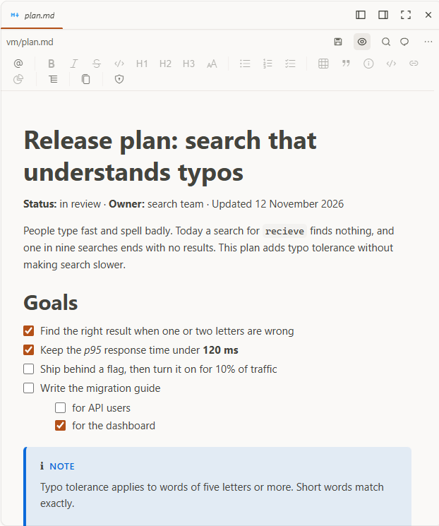
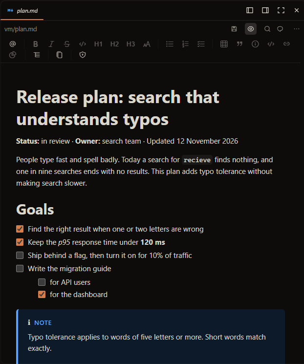

# Visual Markdown

Read and edit Markdown files as documents in [OpenChamber](https://openchamber.dev). The file on disk stays plain Markdown.



Agents write their plans, specs, and notes as Markdown. Visual Markdown shows those files the way they read, with headings, tables, task lists, diagrams, and math, and lets you edit them in place. When you save, it writes the lines you changed and leaves the rest of the file as it was.

## What it does

- **Shows the document.** Headings, lists, task lists, tables, quotes, GitHub alerts, coloured code, Mermaid diagrams, and LaTeX math.
- **Edits in place.** Type in the document, or use the toolbar and the usual shortcuts. Save with Ctrl+S or the app's Save button.
- **Changes only what you change.** Opening a file never changes it. A save keeps your bullet style, numbering, hand-wrapped lines, blank lines, front matter, and line endings. See [What a save changes](#what-a-save-changes).
- **Points the agent at a line.** Put the caret on a line, or select a few, and press the @ button. A reference such as `@docs/plan.md#L10-14` goes into the chat box.
- **Keeps up with the agent.** When something else changes the file, the document reloads and you stay at the same place.
- **Looks like the app.** It takes the app's theme, fonts, and code colours, in light and dark. Diagrams use the same colours.
- **Helps you find things.** An outline, find (Ctrl+F), a link dialog that searches the project's files, and an audit that lists links and pictures pointing at files that don't exist.

The toolbar is translated into Spanish, Japanese, Brazilian Portuguese, Russian, and Simplified Chinese when the app is set to one of them.



## Install it

1. In OpenChamber, open **Settings**, then **Extensions**.
2. Choose **Add extension**.
3. Paste `https://github.com/TrellaceTeam/openchamber-visual-markdown` and choose **Add**.
4. Read the permission and choose **Allow and enable**.

Then open any `.md` or `.markdown` file from the Files panel. The app's own button in the file header switches between this view and the source text.

Visual Markdown needs OpenChamber 2.7.0 or later.

### The permission it asks for

OpenChamber asks you to allow one thing: **Read and write project files**. Visual Markdown uses it to:

- read SVG pictures that a document shows
- list folders, so the link dialog can search for a file
- check whether a link or picture points at a file that exists

It never writes a file itself. Saving goes through OpenChamber: the app asks the editor for the text and writes it.

The editor runs in OpenChamber's sandbox and has no network access. It names no outside hosts, so nothing you open in it can be sent anywhere.

## What a save changes

A visual editor has to turn the document back into Markdown, and most write it in one house style. Open a file that uses `*` bullets, edit one word, and every bullet becomes `-`. A hand-wrapped paragraph can come back with a hard break on each line, and a backslash escape can disappear.

Visual Markdown keeps the author's text. For each block you edit, it compares three versions: the block as it was written, the block as the editor would write it, and the block after your edit. It applies your edit to the text as it was written. Before keeping the result, it checks that the editor reads it back as the block on your screen. If that check fails, it saves the block the way the editor wrote it. Then it checks the whole text once more against the document on your screen, and saves the editor's own text if the two differ.

The tests cover 39 sample files that must open and save byte for byte, and 37 styles that must survive an edit. Those styles include `*` and `+` bullets, `1)` numbering, lists numbered all with `1.`, nested lists indented four spaces, loose lists, hand-wrapped paragraphs, quotes, both kinds of hard break, underscore emphasis, tilde code fences, reference links, backslash escapes, comments, compact and padded tables, front matter, and files with no final newline.

Three cases still change more than the words you typed:

- **A padded table whose cell gets wider.** Every row is padded again to line up, as you would do by hand.
- **A heading underlined with `===` or `---`.** Editing it rewrites it as a `#` heading.
- **A block that fails the check.** It is saved in the editor's own style. The other blocks are not affected.
- **A text that fails the last check.** Every block you edited is saved in the editor's own style. Blocks you did not edit keep theirs.

The merge is in [`src/shim/styleMerge.ts`](src/shim/styleMerge.ts).

## What doesn't work yet

- **Pictures.** SVG files in the project show. PNG, JPEG, and other picture files, and pictures on the web, show as a label with their alt text and path. OpenChamber hands an extension a project file as text only, and the sandbox has no network.
- **Adding a picture file.** Pasting or dropping a picture shows a message and changes nothing. To link a picture, paste its path or its web address.
- **Opening a linked file.** OpenChamber has no way for an extension to open another file. Ctrl+click on a link to a file copies its path. Web links open in your browser.
- **Line breaks.** A single line break in the source shows as a line break, as it does in a GitHub comment. GitHub's file view shows it as a space. The file keeps its own line breaks either way.
- **Diagrams in a narrow pane.** A diagram shrinks to the width of the pane. Widen the pane to read a large one.
- **Large files.** On the test PC, a 300 KB file opened in about 2 seconds. A 1 MB file with 12,000 blocks took about 6 seconds, and each keystroke took about a tenth of a second. When you stop typing in a file that size, the page takes up to a second to check the text it will save.
- **Parts of the original editor.** PDF and Word export, feedback review, GitHub Copilot, the split source view, and the settings page depend on VS Code, so they are hidden.

It has been tested on Windows, in the OpenChamber 2.7.0 desktop app. It has not been tested on macOS, on Linux, or in OpenChamber web. OpenChamber's VS Code extension and mobile app don't load extensions.

## Where the editor comes from

The editor is [Markdown Editor for Humans](https://github.com/concretios/markdown-for-humans) by Concret.io, a VS Code extension under the MIT licence. Visual Markdown builds that editor at a pinned version, 0.4.6, with four small patches kept in [`patches/`](patches/). Around it sits a layer of our own in [`src/shim/`](src/shim/), which does the work the VS Code side did: it hands the editor the file, keeps the text a save will write, and passes requests on to OpenChamber.

Visual Markdown is a separate project. Concret.io did not make it and does not endorse it. If you work in VS Code, use their extension.

[THIRD-PARTY-NOTICES.md](THIRD-PARTY-NOTICES.md) lists every package in the build with its licence.

## Work on it

You need Node 20 or later and Git. The browser tests also need a Chromium, either one Playwright has downloaded, Chrome, or Edge. The package check needs [Bun](https://bun.sh).

```bash
npm install
npm run upstream       # fetch the pinned editor into .upstream/ and apply patches/
npm run build          # write editor/
npm run typecheck
npm test               # unit tests
npm run test:harness   # the editor in a real browser, framed the way OpenChamber frames it
npm run check          # OpenChamber's own package check
```

To try a build, add this folder in **Settings**, **Extensions**, **Add extension**.

OpenChamber runs the files in `editor/` as they are and compiles nothing, so `editor/` is committed. Run `npm run build` before you commit a change to the source.

### Change the editor underneath

`scripts/upstream.json` pins the editor's version and commit. To change upstream source, edit the files under `.upstream/markdown-for-humans/src/`, then run `node scripts/make-patch.mjs`. It rewrites the last patch in `patches/` from your edits. Pass a new file name to add a patch.

To move to a newer editor version, change the tag and commit in `scripts/upstream.json`, run `npm run upstream`, fix any patch that no longer applies, and run every test.

## Licence

MIT. See [LICENSE](LICENSE).

Made by [Trellace](https://trellace.com).
