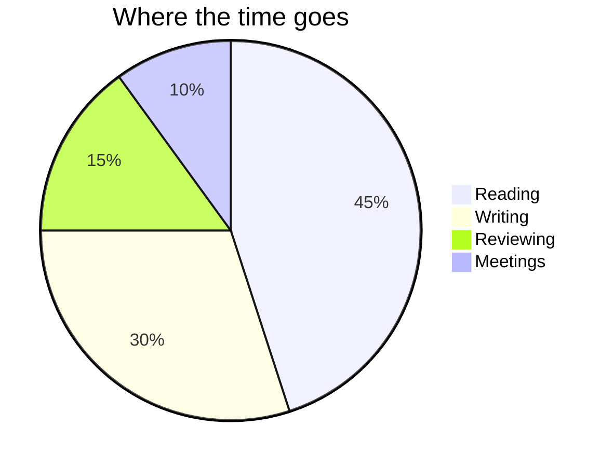
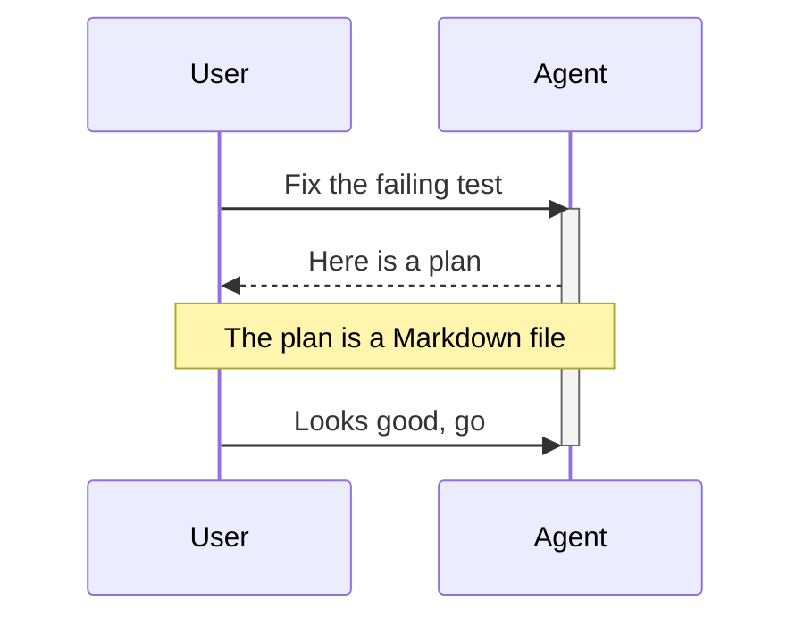
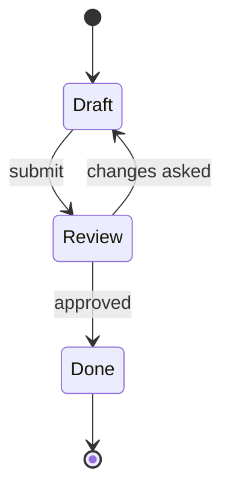

# awesome-tool

[](https://example.com/ci) [](LICENSE) 

> A small tool that does one thing well.


## Install

```bash
npm install awesome-tool
```

## Charts







## Changes

```diff
- const limit = 10;
+ const limit = 100;
```

```python
def greet(name: str) -> str:
    """Say hello."""
    return f"Hello, {name}!"  # a comment
```

| Option | Type | Default |
|--------|------|---------|
| `fast` | boolean | `false` |
| `out` | string | `"dist"` |

See the [guide](docs/guide.md) or the [site](https://example.com).
