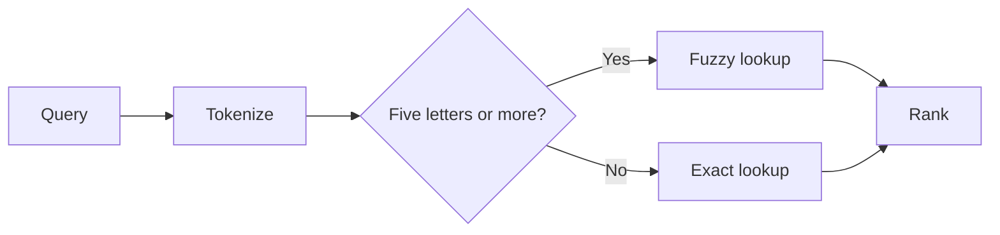

# Release plan: search that understands typos

**Status:** in review · **Owner:** search team · Updated 12 November 2026

People type fast and spell badly. Today a search for `recieve` finds nothing, and one in nine searches ends with no results. This plan adds typo tolerance without making search slower.

## Goals

- [x] Find the right result when one or two letters are wrong
- [x] Keep the *p95* response time under **120 ms**
- [ ] Ship behind a flag, then turn it on for 10% of traffic
- [ ] Write the migration guide
  - [ ] for API users
  - [x] for the dashboard

> [!NOTE]
> Typo tolerance applies to words of five letters or more. Short words match exactly.

## How it works

1. Split the query into words.
2. For each word, look up terms within an edit distance of 2.
3. Rank exact matches first, then one typo, then two.



The cost of a fuzzy lookup grows with the alphabet size $k$ and the word length $n$:

$$
C(n, d) = \sum_{i=0}^{d} \binom{n}{i} k^{i}
$$

## What changes

| Area | Before | After | Risk |
| --- | --- | --- | :---: |
| Index size | 2.1 GB | 2.4 GB | Low |
| p95 latency | 95 ms | 110 ms | Medium |
| Zero-result searches | 11% | 4% | Low |

```ts
export function rank(matches: Match[]): Match[] {
  // Exact matches first, then by number of typos.
  return [...matches].sort((a, b) => a.typos - b.typos || b.score - a.score);
}
```

> Search is the product for half our users. If it gets slower, they notice before we do.

### Open questions

1. Should admins be able to turn this off per index?
2. Do we count a swapped pair (`teh`) as one typo or two?

See the [design doc](https://example.com/design) and press <kbd>Ctrl</kbd> + <kbd>K</kbd> to try it. Water is H<sub>2</sub>O, and that is ~~not~~ relevant here.

---

*Last reviewed by the search team.*
